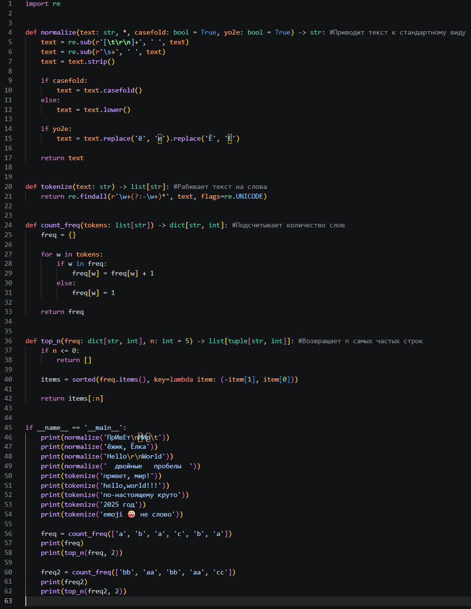
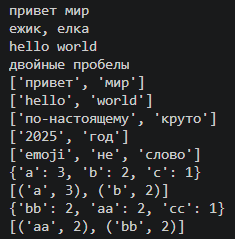
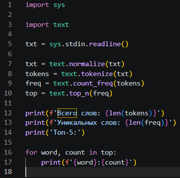
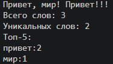

# lab03
## A 
### Привести строку к стандартному виду normalize()
Приводит к casefold (если casefold=True), иначе просто делает все символы нижним регистром заменяет все Ё/ё на Е/е, заменяет управляющие символы на пробелы, убирает повторяющиееся пробелы, выводить строку
normalize(text: str, *, casefold: bool = True, yo2e: bool = True) -> str

### Разбить строку на слова tokenize()
Разбивает строку на список слов, выводит список
tokenize(text: str) -> list[str]

### Подсчитать частоту слов в строке count_freq()
Считает количетво слов в строке, выводит словарь где ключи - слова, а значения - количество этих слов в строке
count_freq(tokens: list[str]) -> dict[str, int]

### Найти топ N слов по убыванию частоты top_n()
Ищет топ N слов по убыванию частоты в словаре, если частота одинаковая, то в алфовитном пораядке, выводит список кортежей, в которых 2 значения, слово и его частота
top_n(freq: dict[str, int], n: int = 5) -> list[tuple[str, int]]

### [Код](text.py)

### Вывод

## B
### Скрипт считает ОДНУ СТРОКУ текста из stdin и вывидит: Кол-во слов, Кол-во уникальных слов, Топ-5 слов по частоте
### [Код](text_stats.py)

### Вывод

