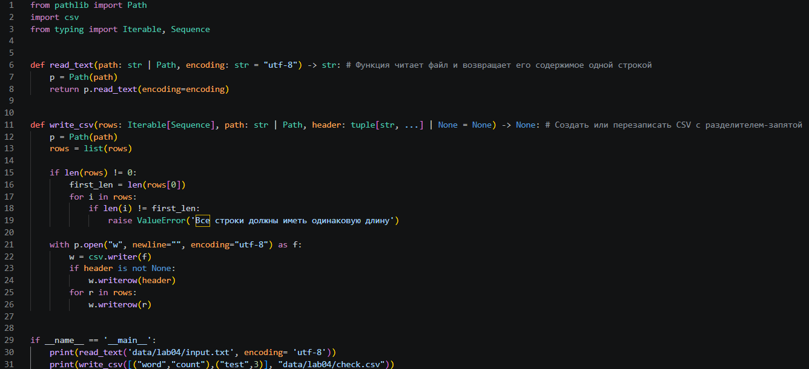
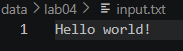
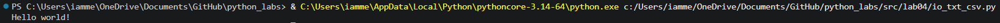
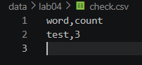
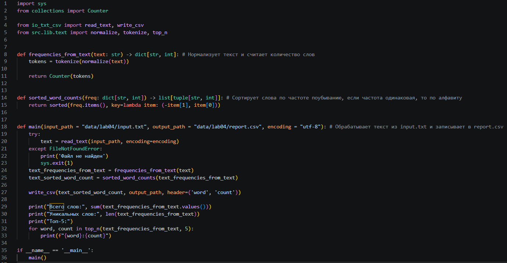
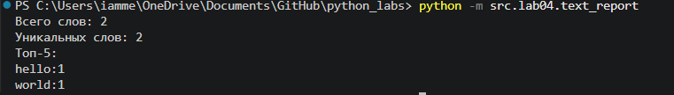
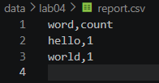

# lab04
## io_txt_csv
### Читает файл в заданой кодировке read_text()
Получает на вход путь к файлу и кодировку для чтения (по умолчанию utf-8), возвращает текст и прочитанного файла  
read_text(path: str | Path, encoding: str = "utf-8") -> str  
Если файл не найден падает с ошибкой FileNotFoundError   
Если кодировка не верная падает с ошибкой UnicodeDecodeError   

### Создает/Перезаписывает csv файл write_csv()
Создает/Перезаписывает check.csv файл с разделителем ",", если есть header (заголовок) записывает его первой строкой, строки в rows должны быть одной длинны  
write_csv(rows: list[tuple | list], path: str | Path, header: tuple[str, ...] | None = None) -> None  
Если строки в rows разной длинны то выдает ValueError   

### [Код](io_txt_csv.py)

### input.txt 

### Вывод

### Вывод (check.csv)

### Краевые случаи
Пустой файл → возвращается пустая строка.  
Файл очень большой → допускается читать целиком, но в реале стоит читать построчно.  
write_csv с пустым rows и header=None → создаётся пустой файл (0 строк).   
С header=("a","b") → файл содержит только заголовок.

## text_report
Запускаем из корня проекта (python -m src.lab04.text_report)  
### Нормализует текст и считает количество слов frequencies_from_text()
frequencies_from_text(text: str) -> dict[str, int]:  

### Сортирует топ слов по частоте sorted_word_counts() 
Сортирует топ слов по частоте, если частота одинаковая, то сортирует по алфавиту  
sorted_word_counts(freq: dict[str, int]) -> list[tuple[str, int]]:  

### Обрабатывает текст из input.txt и записывает в report.csv main()
Читает текст из input.txt, нормализует текст, считает частоты слов в нем, сохраняет топ частот слов в report.csv  
main(input_path = "data/lab04/input.txt", output_path = "data/lab04/report.csv", encoding = "utf-8"):  
### [Код](text_report.py)

### Вывод

### Вывод (report.csv)

### Краевые случаи
data/input.txt не существует → выводит "Файл не найден" и делает sys.exit(1).    
Пустой вход → report.csv будет содержать только заголовок.  
Нестандартная кодировка → указать при выозове main().  
