# lab05
## json_csv
### Переводит json в csv json_to_csv()
Преобразует JSON-файл в CSV.  
Поддерживает список словарей [{...}, {...}], заполняет отсутствующие поля пустыми строками.  
Кодировка UTF-8.   
Порядок колонок — как в первом объекте.  
json_to_csv(json_path: str, csv_path: str) -> None:

### Переводить csv в json csv_to_json()
Преобразует CSV в JSON (список словарей).  
Заголовок обязателен, значения сохраняются как строки.  
csv_to_json(csv_path: str, json_path: str) -> None:

### [Код](json_and_csv.py)
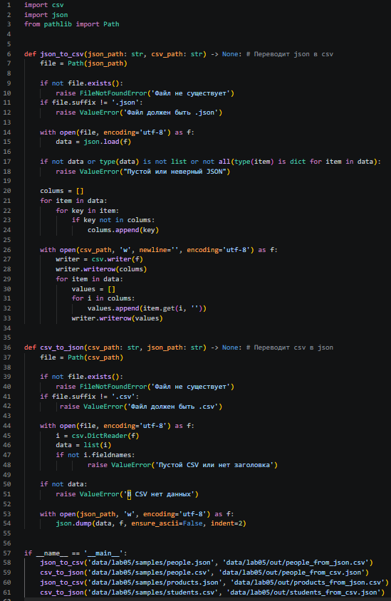

### JSON => CSV
#### people.json -> people_from_json.csv
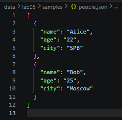
---
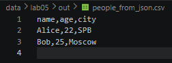

### products.json -> products_from_json.csv
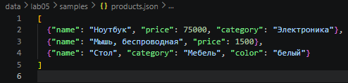
---
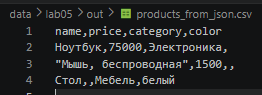

### CSV => JSON
#### people.csv -> people_from_csv.json
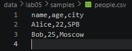
---
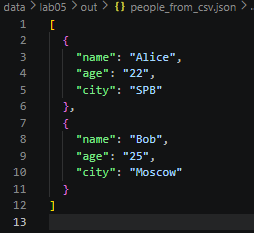

#### students.csv -> students_from_csv.json
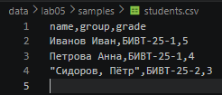
---

### Краевые случаи
Неверный тип файла, пустой JSON или CSV → ValueError.  
Осутствующий файл → FileNotFoundError.  

## csv_xlsx
### Переводить csv в xlsx csv_to_xlsx()
Конвертирует CSV в XLSX.
Первая строка CSV — заголовок.
Лист называется "Sheet1".
Колонки — автоширина по длине текста (не менее 8 символов).
csv_to_xlsx(csv_path: str, xlsx_path: str) -> None:

### [Код](csv_and_xlsx.py)
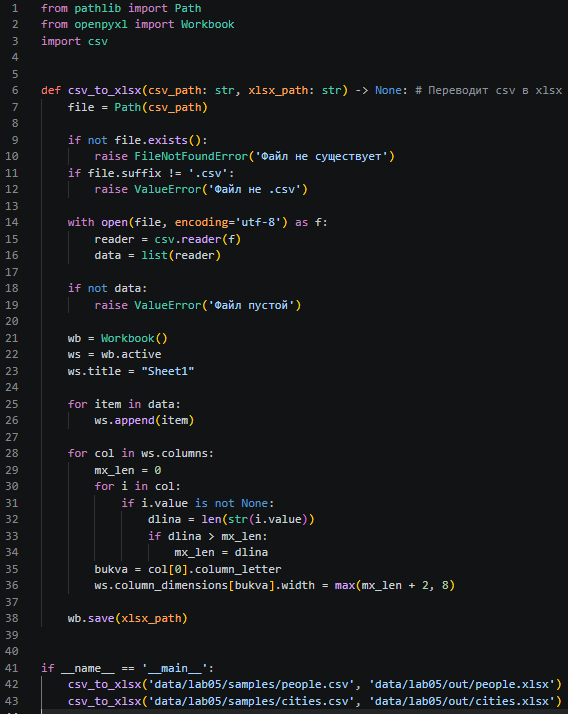

### CSV => XLSX
#### cities.csv -> cities.xlsx
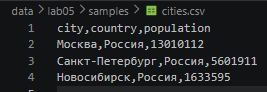
---
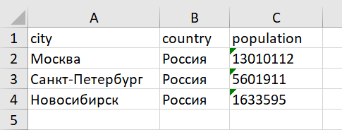

#### people.csv -> people.xlsx

---
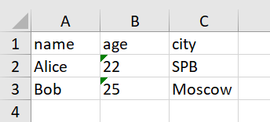

### Краевые случаи
Неверный тип файла, пустой JSON или CSV → ValueError.  
Осутствующий файл → FileNotFoundError.  