# lab05
## cli_text.py
### [Код](cli_text.py)
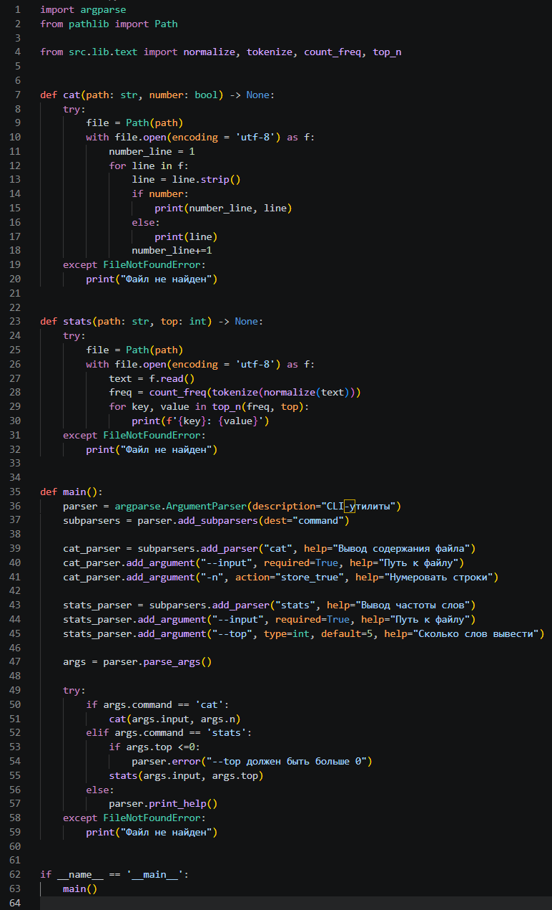

### --help
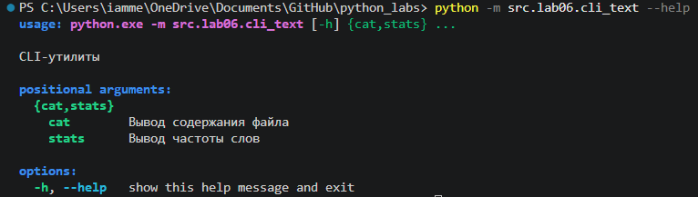

### Вывод cтрок файла cat()
--input - путь к входному файлу  
-n - если нужно нумеровать строки  
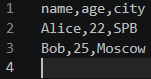  
---
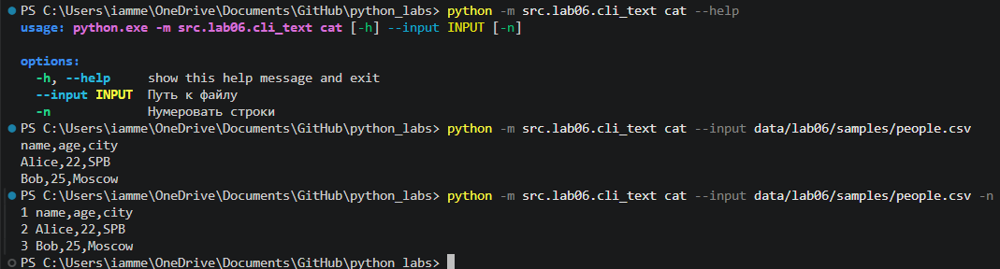  

### Вывод топ слов stats()
--input - путь к входному файлу  
--top - количество слов для вывода (по умолчанию 5)  
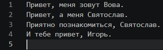  
---
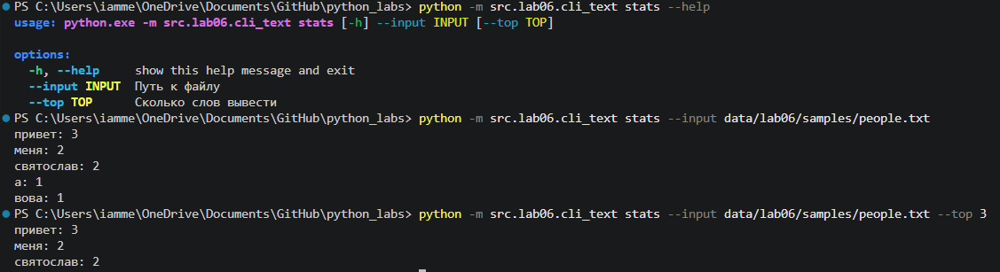  

## cli_convert.py
### [Код](cli_text.py)
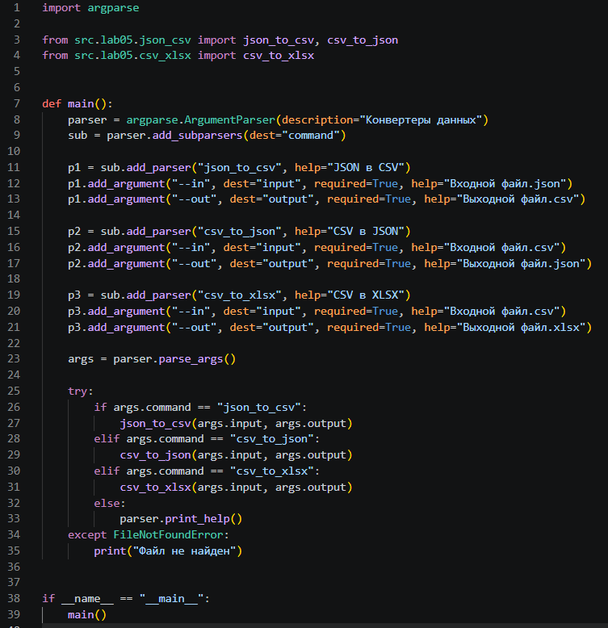

### --help
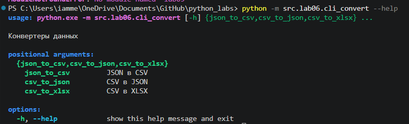

### json_to_csv
--in - путь к входному файлу  
--out - путь к выходному файлу  
#### --help 
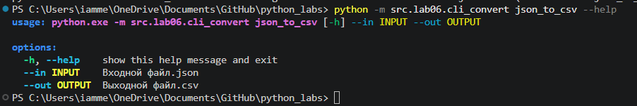

#### people.json -> people.csv

---
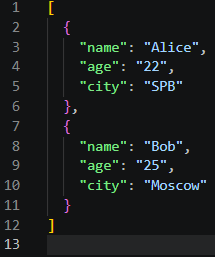
---
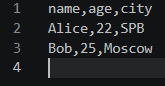

### csv_to_json
--in - путь к входному файлу  
--out - путь к выходному файлу  
#### --help 
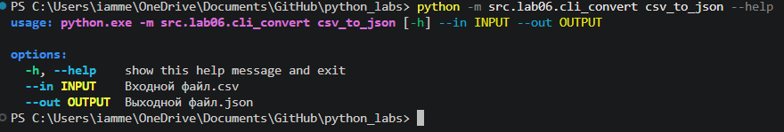

#### people.json -> people.csv
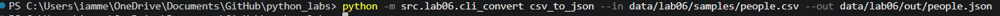
---
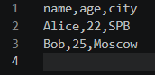
---
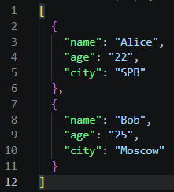

### csv_to_xlsx
--in - путь к входному файлу  
--out - путь к выходному файлу  
#### --help 
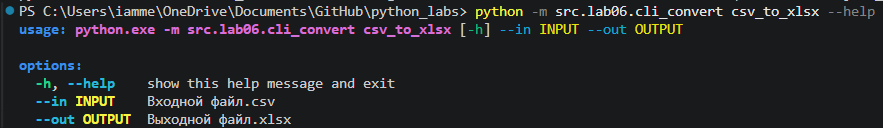

#### people.json -> people.csv
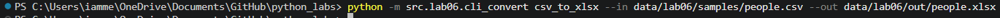
---
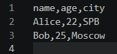
---
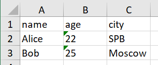

### Краевые случаи
Осутствующий файл → FileNotFoundError.  
top меньше или равен 0 → error: top должен быть больше 0.  
Отсутствие подкоманды →  error: argument command: invalid choice: "" (choose from 'json_to_csv', 'csv_to_json', 'csv_to_xlsx')
